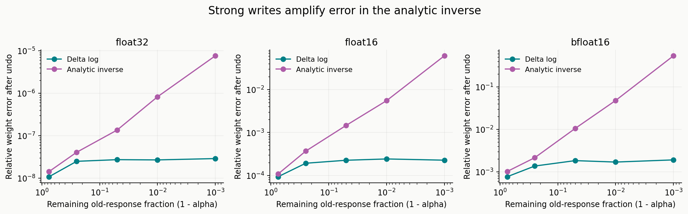
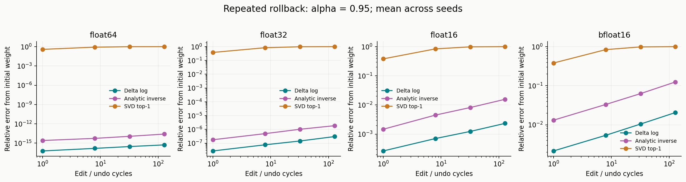
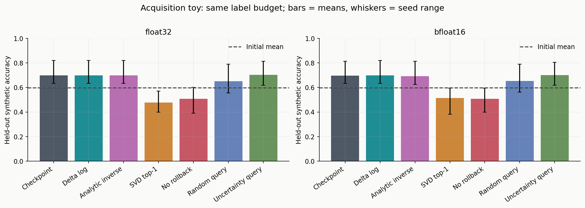

# Reversible Edit Lab — 実行結果

## 今回測ったもの

合成した線形連想記憶に、ROME/MEMITの単一行列・固定目標の更新を適用した結果。事前学習済みLLMの事実編集や、実機TTTの性能を測ったものではない。

- seeds: `7, 23, 61`
- 行列: 出力 12 × 入力 24
- 単発比較: 732件; 反復の観測点: 288件
- 行列演算・記録はfloat64。各重みの書き込み時に指定精度へ丸める。bfloat16は直接丸めをエミュレート。
- SVDは事前に固定したtop-1除去。元重みやテストラベルによるランク選びは行わない。
- 復元器へ渡す情報は方式ごとに限定。評価器は元行列を保持するので、実行プロセスのピークメモリ節約を示す測定ではない。

## 反復したときの復元誤差

書き込み強度 `alpha=0.95` で編集→撤回を 128 回。値はseed間の算術平均。相対Frobenius誤差は `||W_recovered-W_start|| / ||W_start||`。

| 保存精度 | 復元方法 | 相対重み誤差 | probe KL | 次の同じ更新後の相対誤差 |
| --- | --- | ---: | ---: | ---: |
| float64 | Checkpoint | 0 | 0 | 0 |
| float64 | Delta log | 5.396e-16 | 7.447e-18 | 5.138e-16 |
| float64 | Old response | 1.004e-15 | 9.567e-18 | 9.622e-16 |
| float64 | Analytic inverse | 2.582e-14 | 8.42e-18 | 2.463e-14 |
| float64 | SVD top-1 | 1 | 0.01966 | 0.9549 |
| float64 | No rollback | 3.163 | 0.184 | 3.037 |
| float32 | Checkpoint | 0 | 0 | 0 |
| float32 | Delta log | 3.042e-07 | 1.795e-15 | 2.922e-07 |
| float32 | Old response | 3.042e-07 | 1.795e-15 | 2.922e-07 |
| float32 | Analytic inverse | 1.869e-06 | 6.933e-14 | 1.799e-06 |
| float32 | SVD top-1 | 1 | 0.01966 | 0.9549 |
| float32 | No rollback | 3.163 | 0.184 | 3.037 |
| float16 | Checkpoint | 0 | 0 | 0 |
| float16 | Delta log | 0.002342 | 1.038e-07 | 0.002275 |
| float16 | Old response | 0.002342 | 1.038e-07 | 0.002275 |
| float16 | Analytic inverse | 0.01568 | 4.993e-06 | 0.01496 |
| float16 | SVD top-1 | 1 | 0.01966 | 0.9549 |
| float16 | No rollback | 3.163 | 0.184 | 3.037 |
| bfloat16 | Checkpoint | 0 | 0 | 0 |
| bfloat16 | Delta log | 0.02058 | 8.055e-06 | 0.01975 |
| bfloat16 | Old response | 0.02058 | 8.055e-06 | 0.01975 |
| bfloat16 | Analytic inverse | 0.1249 | 0.0002916 | 0.1193 |
| bfloat16 | SVD top-1 | 0.9999 | 0.01965 | 0.9548 |
| bfloat16 | No rollback | 3.162 | 0.1839 | 3.036 |

## 情報の保存量

`kernel.csv` は復元用数値ペイロードの実サイズを記録する。差分因子・内部目標・方向・共分散をfloat64で保存する費用を含む。Pythonオブジェクト、NPZの圧縮率、一時作業メモリは含めない。

小さな行列では、MEMIT逆変換用の密な共分散がチェックポイントより大きくなる。『元の重みを保存しない』ことからメモリ節約を自動的に結論しない。

## 能動的な問い合わせのtoy実験

同じ初期分類器から、各候補ラベルを仮編集して未ラベルprobeの期待エントロピー減少を採点する。教師への問い合わせは選択確定後に1ラウンド1回だけ。テストラベルは採点専用。

以下は候補を順方向に評価した実行。チェックポイントとの経路一致は、全ラウンドの問い合わせ先列が一致したseed数。random/uncertaintyは同じラベル予算・本更新則だが計算量を一致させていない。3seed等の小規模結果から優位性の統計的主張はしない。

| 精度 | 方法 | 開始精度 | 最終精度 | 経路一致 / seeds | 仮編集数 |
| --- | --- | ---: | ---: | ---: | ---: |
| float64 | Checkpoint | 59.64% | 69.79% | 3/3 | 144 |
| float64 | Delta log | 59.64% | 69.79% | 3/3 | 144 |
| float64 | Analytic inverse | 59.64% | 69.79% | 3/3 | 144 |
| float64 | SVD top-1 | 59.64% | 45.83% | 0/3 | 144 |
| float64 | No rollback | 59.64% | 50.78% | 0/3 | 144 |
| float64 | Random query | 59.64% | 65.10% | — | 0 |
| float64 | Uncertainty query | 59.64% | 70.31% | — | 0 |
| float32 | Checkpoint | 59.64% | 69.79% | 3/3 | 144 |
| float32 | Delta log | 59.64% | 69.79% | 3/3 | 144 |
| float32 | Analytic inverse | 59.64% | 69.79% | 3/3 | 144 |
| float32 | SVD top-1 | 59.64% | 47.66% | 0/3 | 144 |
| float32 | No rollback | 59.64% | 50.78% | 0/3 | 144 |
| float32 | Random query | 59.64% | 65.10% | — | 0 |
| float32 | Uncertainty query | 59.64% | 70.31% | — | 0 |
| float16 | Checkpoint | 59.64% | 69.79% | 3/3 | 144 |
| float16 | Delta log | 59.64% | 69.79% | 3/3 | 144 |
| float16 | Analytic inverse | 59.64% | 69.79% | 3/3 | 144 |
| float16 | SVD top-1 | 59.64% | 51.30% | 0/3 | 144 |
| float16 | No rollback | 59.64% | 50.78% | 0/3 | 144 |
| float16 | Random query | 59.64% | 65.10% | — | 0 |
| float16 | Uncertainty query | 59.64% | 70.31% | — | 0 |
| bfloat16 | Checkpoint | 59.64% | 69.53% | 3/3 | 144 |
| bfloat16 | Delta log | 59.64% | 69.79% | 3/3 | 144 |
| bfloat16 | Analytic inverse | 59.64% | 69.27% | 3/3 | 144 |
| bfloat16 | SVD top-1 | 59.64% | 51.30% | 0/3 | 144 |
| bfloat16 | No rollback | 59.64% | 50.78% | 0/3 | 144 |
| bfloat16 | Random query | 59.64% | 65.36% | — | 0 |
| bfloat16 | Uncertainty query | 59.64% | 70.05% | — | 0 |

復元の忠実さと選択方針の良さは別に評価する。期待エントロピー減少は自信の増加を測る代理目的で、正確さの改善を保証しない。`results.json` に逆順評価・seed別の全履歴・外部ラベル問い合わせ数を残した。

## 過去の一編集だけを引く場合

スカラー状態0をAで1、Bで2に上書きすると、Aの差分だけ引いた値は **1**。AがなくBだけを学んだ値は **2**。B→Aの順に戻してBを再計算した値は **2**。

重なるキーを持つ行列例でも、単純な差分除去の相対誤差は `0.725039`、巻き戻して再適用した相対誤差は `1.24922e-16`。後続更新が先行更新に依存することを示す。

## 再現と読み方

- `results.json`: 全設定、seed別の生結果、環境情報、ソースのSHA-256。
- `kernel.csv`: 単発の復元、書き込みの強さ、数値ペイロード量、次の更新。
- `cycles.csv`: 編集と撤回の反復。
- `summary.json`: 本ページの集計。
- `../docs/METHODS.md` またはプロジェクト直下の `docs/METHODS.md`: 前提と比較条件。

実行時間は参考値で、ハードウェア性能や全LLMの推論速度の比較には使用しない。

## 図

