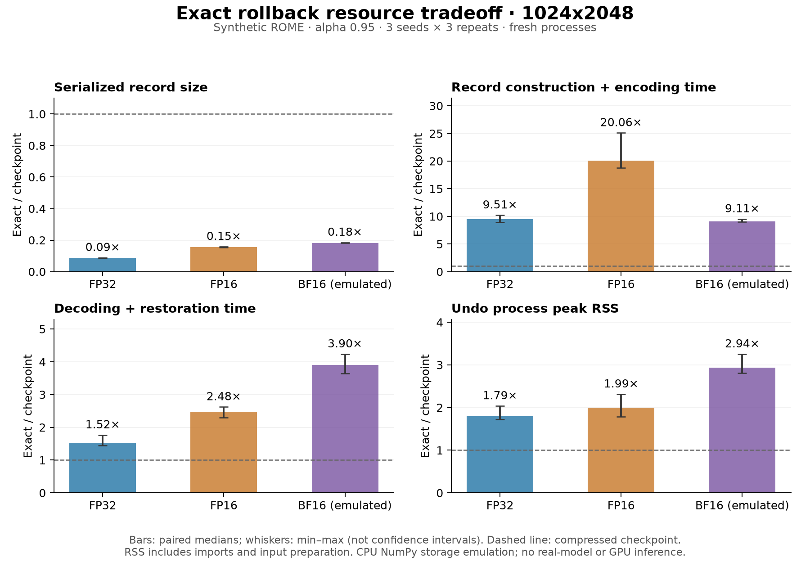

# Resource pilot: retained findings

Numerical source and protocol were committed as `22cc0fe9df116307b7bc47e37a14c4cc17648e42`
before this run. This interpretation and plot were added after the measurements.
The full table and measurement boundary are in [RESULTS.md](RESULTS.md).

All 243 paired observations completed in 123.6 seconds without worker failures.
Each method has 27 unique seeded fixtures × 3 timing repeats. Exact correction
restored bits in 81/81 observations; compressed checkpoint also did so in 81/81;
ordinary delta did so in 0/81. Timing repeats are not additional independent
scientific seeds. All writes had remaining target residual fractions between
0.04994 and 0.05002, consistent with the predeclared alpha 0.95.

At the largest planned size, 1024×2048, the paired exact/checkpoint median ratios
were:

| Storage precision | Serialized bytes | Build time | Undo time | Build process peak RSS | Undo process peak RSS |
| --- | ---: | ---: | ---: | ---: | ---: |
| FP32 | 8.67% | 9.51× | 1.52× | 2.17× | 1.79× |
| FP16 | 15.48% | 20.06× | 2.48× | 2.49× | 1.99× |
| Emulated BF16 | 18.12% | 9.11× | 3.90× | 2.98× | 2.94× |

The artifact-size reduction is substantial in these fixtures, while this
implementation's extra construction time and process memory are also material.
No general speed or memory advantage is supported here. These are single-host
measurements of record handling, excluding forward editing, process startup,
input disk reads, and output disk writes. RSS is a process high-water metric,
not an isolated allocation measurement. BF16 in-memory arrays are float32.



The predeclared design was not changed after seeing the results. A useful next
experiment is to profile correction construction and test a predeclared
compression-level tradeoff while preserving exactness and total serialized
bytes. Actual model tensors and real update factors remain a separate planned
validation step, rather than a conclusion from this synthetic pilot.

## Artifact checks

The post-run audit verified all 20 recorded source hashes, 27 fixture-file
hashes, and 243 serialized record hashes and byte lengths. The audit is stored
in [resource-cost-summary.json](../../validation/resource-cost-summary.json).
The retained environment used Python 3.12.6, NumPy 2.5.4, macOS arm64, and
one-thread BLAS settings. NumPy's build configuration is in [run.json](run.json).

Recreate the figure from raw observations with:

```bash
.venv/bin/python -I scripts/plot_resource_costs.py results/20261110_costs
```

RSS unit references: [Darwin getrusage manual source](https://github.com/apple/darwin-xnu/blob/main/bsd/man/man2/getrusage.2)
and [Linux getrusage manual](https://man7.org/linux/man-pages/man2/getrusage.2.html).
