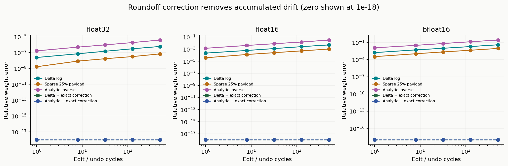
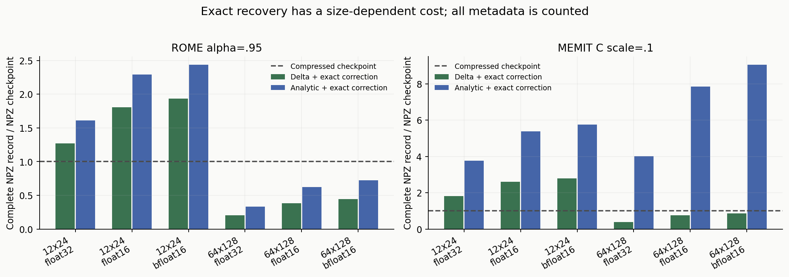
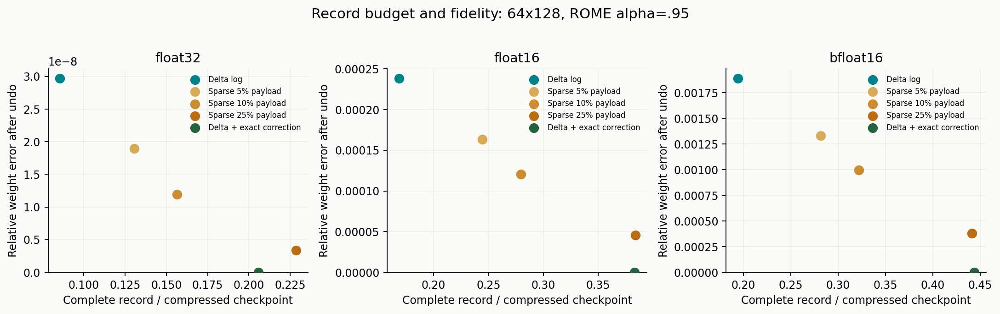

# Reversible Edit Lab v0.2 — 丸め補正の再実験

## 問いと実装

通常の復元の後に残る丸め誤差を、編集時に作る補助記録で補正した。補正の作成時には編集前状態を使う。復元時には元行列を渡さず、編集後行列と復元記録のみを使う。これは元情報を一切使わない盲目的な復元ではない。

厳密補正は、元行列と予測復元の保存ビットのXORをzlibで可逆圧縮する。部分補正は数値誤差の大きい要素を選ぶ。部分補正の5/10/25%は元行列の論理保存バイト数に対する補正データ予算であり、メタデータや因子を含む総量ではない。以下の容量比較にはすべてを含む実際のNPZサイズを使う。

設定: seeds=(7, 23, 61), precisions=('float32', 'float16', 'bfloat16'), shapes=((12, 24), (64, 128))。
単発比較 846件、反復観測 270件。厳密補正の単発ビット一致は 234/234。

## 反復して戻した後

ROME alpha=.95、編集→撤回を512回。反復中に使った記録は撤回直後に破棄する。重み誤差はseed間の平均。

| 保存精度 | 方式 | 相対重み誤差 | 全ステップの厳密復元 | 次の同一更新までビット一致 |
| --- | --- | ---: | ---: | ---: |
| float32 | Delta log | 6.02335e-07 | 0/1536 | 0/3 |
| float32 | Delta + exact correction | 0 | 1536/1536 | 3/3 |
| float32 | Sparse 5% payload | 4.12679e-07 | 0/1536 | 0/3 |
| float32 | Sparse 25% payload | 6.95703e-08 | 149/1536 | 0/3 |
| float32 | Analytic inverse | 3.89163e-06 | 0/1536 | 0/3 |
| float32 | Analytic + exact correction | 0 | 1536/1536 | 3/3 |
| float16 | Delta log | 0.00493918 | 0/1536 | 0/3 |
| float16 | Delta + exact correction | 0 | 1536/1536 | 3/3 |
| float16 | Sparse 5% payload | 0.00349586 | 0/1536 | 0/3 |
| float16 | Sparse 25% payload | 0.00102123 | 10/1536 | 0/3 |
| float16 | Analytic inverse | 0.0314224 | 0/1536 | 0/3 |
| float16 | Analytic + exact correction | 0 | 1536/1536 | 3/3 |
| bfloat16 | Delta log | 0.0381683 | 0/1536 | 0/3 |
| bfloat16 | Delta + exact correction | 0 | 1536/1536 | 3/3 |
| bfloat16 | Sparse 5% payload | 0.0289915 | 0/1536 | 0/3 |
| bfloat16 | Sparse 25% payload | 0.00879098 | 12/1536 | 0/3 |
| bfloat16 | Analytic inverse | 0.255714 | 0/1536 | 0/3 |
| bfloat16 | Analytic + exact correction | 0 | 1536/1536 | 3/3 |

## 役立つ強さの書き込みと記録容量

ROMEはalpha=.95、MEMITは保持共分散を0.1倍にした条件。各値は3seed等の設定seed数で平均。チェックポイントもNPZ圧縮済みで、BF16は16ビットの論理表現を保存する。メタデータの再利用・共分散の償却は仮定しない。alpha=0の無更新対照はこの表に含めない。

| 編集器 | 行列 | 精度 | 方式 | 復元記録 bytes | 圧縮checkpoint bytes | 比率 | 相対重み誤差 |
| --- | --- | --- | --- | ---: | ---: | ---: | ---: |
| rome | 12×24 | float32 | Delta log | 1373.0 | 1730.0 | 79.4% | 2.257e-08 |
| rome | 12×24 | float32 | Delta + exact correction | 2196.0 | 1730.0 | 126.9% | 0 |
| rome | 12×24 | float32 | Sparse 25% payload | 2089.0 | 1730.0 | 120.8% | 2.807e-09 |
| rome | 12×24 | float32 | Analytic + exact correction | 2786.3 | 1730.0 | 161.1% | 0 |
| memit | 12×24 | float32 | Delta log | 2262.0 | 1730.0 | 130.8% | 4.699e-08 |
| memit | 12×24 | float32 | Delta + exact correction | 3156.7 | 1730.0 | 182.5% | 0 |
| memit | 12×24 | float32 | Sparse 25% payload | 2983.0 | 1730.0 | 172.4% | 1.426e-08 |
| memit | 12×24 | float32 | Analytic + exact correction | 6501.7 | 1730.0 | 375.8% | 0 |
| rome | 12×24 | float16 | Delta log | 1373.3 | 1195.3 | 114.9% | 0.000185 |
| rome | 12×24 | float16 | Delta + exact correction | 2158.3 | 1195.3 | 180.6% | 0 |
| rome | 12×24 | float16 | Sparse 25% payload | 2041.7 | 1195.3 | 170.8% | 2.798e-05 |
| rome | 12×24 | float16 | Analytic + exact correction | 2741.7 | 1195.3 | 229.4% | 0 |
| memit | 12×24 | float16 | Delta log | 2265.0 | 1195.3 | 189.5% | 0.000343 |
| memit | 12×24 | float16 | Delta + exact correction | 3119.7 | 1195.3 | 261.0% | 0 |
| memit | 12×24 | float16 | Sparse 25% payload | 2930.7 | 1195.3 | 245.2% | 0.0001374 |
| memit | 12×24 | float16 | Analytic + exact correction | 6430.7 | 1195.3 | 538.0% | 0 |
| rome | 12×24 | bfloat16 | Delta log | 1375.3 | 1119.7 | 122.8% | 0.00145 |
| rome | 12×24 | bfloat16 | Delta + exact correction | 2165.3 | 1119.7 | 193.4% | 0 |
| rome | 12×24 | bfloat16 | Sparse 25% payload | 2041.0 | 1119.7 | 182.3% | 0.0002708 |
| rome | 12×24 | bfloat16 | Analytic + exact correction | 2728.0 | 1119.7 | 243.6% | 0 |
| memit | 12×24 | bfloat16 | Delta log | 2267.3 | 1119.7 | 202.5% | 0.002807 |
| memit | 12×24 | bfloat16 | Delta + exact correction | 3132.7 | 1119.7 | 279.8% | 0 |
| memit | 12×24 | bfloat16 | Sparse 25% payload | 2937.0 | 1119.7 | 262.3% | 0.001154 |
| memit | 12×24 | bfloat16 | Analytic + exact correction | 6434.3 | 1119.7 | 574.7% | 0 |
| rome | 64×128 | float32 | Delta log | 2652.0 | 31029.3 | 8.5% | 2.971e-08 |
| rome | 64×128 | float32 | Delta + exact correction | 6384.0 | 31029.3 | 20.6% | 0 |
| rome | 64×128 | float32 | Sparse 25% payload | 7095.7 | 31029.3 | 22.9% | 3.352e-09 |
| rome | 64×128 | float32 | Analytic + exact correction | 10406.3 | 31029.3 | 33.5% | 0 |
| memit | 64×128 | float32 | Delta log | 7024.3 | 31029.3 | 22.6% | 4.774e-08 |
| memit | 64×128 | float32 | Delta + exact correction | 12250.0 | 31029.3 | 39.5% | 0 |
| memit | 64×128 | float32 | Sparse 25% payload | 11674.7 | 31029.3 | 37.6% | 1.54e-08 |
| memit | 64×128 | float32 | Analytic + exact correction | 124421.3 | 31029.3 | 401.0% | 0 |
| rome | 64×128 | float16 | Delta log | 2650.3 | 15728.7 | 16.9% | 0.0002385 |
| rome | 64×128 | float16 | Delta + exact correction | 6024.3 | 15728.7 | 38.3% | 0 |
| rome | 64×128 | float16 | Sparse 25% payload | 6034.3 | 15728.7 | 38.4% | 4.56e-05 |
| rome | 64×128 | float16 | Analytic + exact correction | 9792.0 | 15728.7 | 62.3% | 0 |
| memit | 64×128 | float16 | Delta log | 7022.3 | 15728.7 | 44.6% | 0.0003894 |
| memit | 64×128 | float16 | Delta + exact correction | 11793.7 | 15728.7 | 75.0% | 0 |
| memit | 64×128 | float16 | Sparse 25% payload | 10471.0 | 15728.7 | 66.6% | 0.000177 |
| memit | 64×128 | float16 | Analytic + exact correction | 123605.3 | 15728.7 | 785.9% | 0 |
| rome | 64×128 | bfloat16 | Delta log | 2652.7 | 13660.7 | 19.4% | 0.00189 |
| rome | 64×128 | bfloat16 | Delta + exact correction | 6062.0 | 13660.7 | 44.4% | 0 |
| rome | 64×128 | bfloat16 | Sparse 25% payload | 6030.7 | 13660.7 | 44.1% | 0.0003783 |
| rome | 64×128 | bfloat16 | Analytic + exact correction | 9846.7 | 13660.7 | 72.1% | 0 |
| memit | 64×128 | bfloat16 | Delta log | 7025.3 | 13660.7 | 51.4% | 0.003128 |
| memit | 64×128 | bfloat16 | Delta + exact correction | 11813.3 | 13660.7 | 86.5% | 0 |
| memit | 64×128 | bfloat16 | Sparse 25% payload | 10477.0 | 13660.7 | 76.7% | 0.001415 |
| memit | 64×128 | bfloat16 | Analytic + exact correction | 123676.7 | 13660.7 | 905.3% | 0 |

小さい行列ではヘッダーやダイジェストが支配し、補正記録がチェックポイントを上回り得る。MEMITの解析方式は密な共分散も毎回含む。容量の優位は一律ではなく、サイズ・更新強度・保存精度・記録方式の条件を持つ。

## 次に何を問い合わせるか

v0.1と同じ期待エントロピー減少の取得方針で、復元の変更が判断と最終状態へどう伝わるかを測定した。教師ラベルは選択後だけ取得。取得方針の性能優位を新たに主張する実験ではない。表は順方向評価、逆順も生データに含む。

| 精度 | 方式 | 最終分類精度 | 問い合わせ系列がcheckpointと一致 | 最終重みもビット一致 |
| --- | --- | ---: | ---: | ---: |
| float32 | Checkpoint | 69.79% | 3/3 | 3/3 |
| float32 | Delta log | 69.79% | 3/3 | 0/3 |
| float32 | Analytic inverse | 69.79% | 3/3 | 0/3 |
| float32 | Delta + exact correction | 69.79% | 3/3 | 3/3 |
| float32 | Analytic + exact correction | 69.79% | 3/3 | 3/3 |
| float32 | Sparse 25% payload | 69.79% | 3/3 | 0/3 |
| float16 | Checkpoint | 69.79% | 3/3 | 3/3 |
| float16 | Delta log | 69.79% | 3/3 | 0/3 |
| float16 | Analytic inverse | 69.79% | 3/3 | 0/3 |
| float16 | Delta + exact correction | 69.79% | 3/3 | 3/3 |
| float16 | Analytic + exact correction | 69.79% | 3/3 | 3/3 |
| float16 | Sparse 25% payload | 69.79% | 3/3 | 0/3 |
| bfloat16 | Checkpoint | 69.53% | 3/3 | 3/3 |
| bfloat16 | Delta log | 69.79% | 3/3 | 0/3 |
| bfloat16 | Analytic inverse | 69.27% | 3/3 | 0/3 |
| bfloat16 | Delta + exact correction | 69.53% | 3/3 | 3/3 |
| bfloat16 | Analytic + exact correction | 69.53% | 3/3 | 3/3 |
| bfloat16 | Sparse 25% payload | 69.53% | 3/3 | 0/3 |

## 連続する保存済み記録の巻き戻し

hard ROMEで8回連続して編集し、最後の行列とシリアライズ済み記録だけを逆順の復元処理へ渡した。途中の全状態ダイジェストまで比較する。

- float32: 8段、途中状態すべて一致=True、初期状態とビット一致=True。
- float16: 8段、途中状態すべて一致=True、初期状態とビット一致=True。
- bfloat16: 8段、途中状態すべて一致=True、初期状態とビット一致=True。

厳密補正は、作成時と同じビット列の予測復元を再計算することが条件。異なる演算環境等で予測が変わればダイジェスト検査で拒否する。後続編集を残して途中の編集だけを差し引く機能とは別で、意味の依存関係は再適用時に扱う必要がある。

## 結果の範囲

- 合成した固定ターゲットの線形更新。事前学習済みLLMの実行は行っていない。
- ビット一致は補正の設計から期待される性質。実験で確かめた価値は、その実装と記録容量、反復、後続学習の整合。
- 補助記録には旧状態の情報を保持する。無記録の重み復元を達成したものではない。
- 圧縮ファイル容量とプロセスのピークメモリは別。評価器は元行列や一時コピーを保持する。
- 処理時間には補正構築・ハッシュ・圧縮・復元の費用がある。記録が小さいことから高速化を結論しない。

## 証拠ファイル

`results.json`に設定・全生データ・ソースハッシュ、`tradeoffs.csv`に容量と誤差、`cycles.csv`に反復経過、`summary.json`に本ページの集計を収録。

